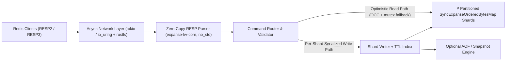

# PRD: Multi-Threaded, Redis-Protocol-Compatible KV & Cache (`expanse-kv`)

> **Status:** Draft (Phase 0 in progress: workspace and CI exist; no measurement yet)  
> **Primary Index Dependency:** [`orieg/expanse`](https://github.com/orieg/expanse) (`expanse-trie`)  
> **Scope:** Strictly in-memory KV/cache engine with optional AOF and binary snapshot persistence (no disk-tiered or device-backed value storage).  
> **Rules:** [`AGENTS.md`](../AGENTS.md) governs how this plan is executed; where the two disagree, `AGENTS.md` wins and this document is corrected.

---

## 1. Executive Summary & Problem Statement

In-memory key-value stores and caches (`Redis`, `Valkey`, `Memcached`) sit on the critical path of modern web, API, and AI serving stacks. Incumbent C implementations carry three structural limitations:

1. **Memory-safety exposure:** Network-facing C parsers (RESP wire protocol, Lua/module surfaces, RDB/AOF loaders) remain exposed to buffer overflows and use-after-free defects.
2. **Single-threaded execution model:** `Redis` and `Valkey` execute commands on a single main thread per process (with I/O threads limited to socket read/write), requiring multi-process sharding to saturate multi-core hosts.
3. **Dual-structure memory overhead:** Hash-table-backed keyspaces cannot natively serve ordered range or prefix queries, forcing separate hash tables and skip lists (`zset`) and driving up bytes-per-key overhead on structured, prefix-heavy keys (e.g., `org:user:session:*`).

**`expanse-kv`** is a memory-safe, multi-threaded, in-memory RESP2/RESP3-compatible KV store and cache written in Rust, backed by [`orieg/expanse`](https://github.com/orieg/expanse)'s 256-ary radix tries (`SyncExpanseOrderedBytesMap`, `SyncExpanseSet`, and `BlobArena`-style in-memory value storage). It targets multi-core read-heavy scaling via optimistic concurrency, compact memory density on prefix-heavy and integer-keyed workloads, and native ordered prefix/range scans—while remaining drop-in compatible with standard Redis clients.

---

## 2. Goals & Non-Goals

### Goals
- **Drop-in client compatibility:** Support RESP2 and RESP3 over TCP and TLS (`rustls`), passing the targeted subset of the official Redis/Valkey Tcl test suite and differential fuzzing.
- **Multi-core read scaling:** Serve concurrent read workloads across cores using `expanse-trie`'s optimistic concurrent readers (`SyncExpanse*`), with shard count $P$ chosen empirically from a Phase 0 scaling curve.
- **Unified ordered keyspace:** Serve point lookups, prefix scans (`SCAN` with prefix match), and ordered range queries (`ZRANGE`, `ZRANGEBYLEX`, TTL expiration) directly from lexicographically ordered radix tries with prefix compression.
- **Memory-safe wire & persistence parsing:** Zero `unsafe` in the RESP parser, command router, and AOF/snapshot framing layers.
- **Reproducible, equal-core benchmarking:** Fair comparisons against both equal-core sharded `Valkey` (one shard per core) and multi-threaded `Dragonfly`, using paired per-round ratios, BCa 95% confidence intervals, and explicit disclosure of regimes where incumbents win.

### Non-Goals (MVP)
- **No device-backed / disk-tiered value storage:** The working dataset lives strictly in RAM; disk is used only for optional AOF logging and snapshots.
- Full Redis Cluster gossip protocol, Redis Sentinel, or cross-slot Raft consensus (single-node primary is the MVP scope).
- Embedded Lua (`EVAL`/`EVALSHA`) or Redis C-module ABI compatibility (`RedisModule_*`).
- Rewriting `expanse-trie` internals; any missing primitive (e.g., optimistic reverse cursor support) is tracked as an upstream `orieg/expanse` issue/PR.

---

## 3. Architectural Design & `expanse-trie` Mapping

### 3.1 Avoiding the Many-Small-Maps Trap (`orieg/expanse#1742`)
Per `orieg/expanse`'s documented performance envelope, allocating millions of tiny independent maps incurs high per-tree slab-page memory and insert overhead. Therefore, `expanse-kv` **must NOT** allocate one trie per Redis Hash, Set, or Sorted Set.

Instead, all logical structures share a **bounded set of $P$ large, hot, partitioned tries** using composite binary key prefixes.

### 3.2 Selecting the Correct `expanse-trie` Types
Upstream `expanse-trie` provides distinct map semantics that must not be conflated:
- **`SyncExpanseOrderedBytesMap`** (wrapping `ExpanseOrderedBytesMap`): maps arbitrary `&[u8]` keys to `u64` values in **strict byte-lexicographical order** (via an internal order-preserving escape encoding for `0x00`/`0x01`). This is the required structure for `SCAN`, `HSCAN`, `ZRANGE`, and the TTL expiration index.
- **`SyncExpanseBytesMap`** (wrapping `ExpanseBytesMap`): an **unordered** hash-keyed map (JudyHS contract) — unsuitable for `SCAN` prefix seeks, `ZRANGE`, or ordered TTL sweeps.
- **`SyncExpanseBlobMap`** (wrapping `ExpanseBlobMap`): maps **64-bit integer keys (`u64`)** to variable-length byte payloads via `BlobArena` + `ValueSlot` (inline `<= 7 B`, slab-allocated above that). Because Redis keys are arbitrary byte strings, `expanse-kv` stores `u64` value handles/slots inside `SyncExpanseOrderedBytesMap` pointing into an in-memory value arena/slab (or `BlobArena`), rather than indexing byte keys in `SyncExpanseBlobMap`.

| Logical Redis Type | Backing `expanse-trie` Structure | Key Encoding / Value Layout |
| :--- | :--- | :--- |
| **String / Binary KV** | `SyncExpanseOrderedBytesMap` (+ in-memory value slab/arena) | `[0x01][key_bytes]` → `u64` slot/handle to `[type, flags, lru24, expiry_ms, value_bytes]` |
| **Hash (`HSET`/`HGET`/`HSCAN`)** | Shared `SyncExpanseOrderedBytesMap` (+ value slab) | `[0x02][len_varint(key)][key][field]` → `u64` value handle (prefix scan serves `HSCAN`/`HGETALL`) |
| **Sorted Set (`ZSET`)** | Shared `SyncExpanseOrderedBytesMap` (score index + member→score) | Score index: `[0x03][len_varint(key)][key][order_preserving_u64(score)][member]` → `1`; Member index: `[0x04][len_varint(key)][key][member]` → raw `f64` bits |
| **Sparse Bitmap (`SETBIT`/`GETBIT`/`BITCOUNT`)** | `SyncExpanseSet` (for large sparse bitmaps) | 64-bit bit offsets directly in `SyncExpanseSet` |
| **TTL / Expiration Index** | Shared `SyncExpanseOrderedBytesMap` | `[expiry_ms_be_u64][key_bytes]` → `1` (ordered passive + active background sweep by timestamp prefix) |

> [!IMPORTANT]
> Encoding IEEE-754 `f64` scores into order-preserving big-endian `u64` (flipping the sign bit for positive values and all bits for negative values) allows `ZRANGE` and `ZRANGEBYSCORE` to execute as direct lexicographical range scans over `SyncExpanseOrderedBytesMap` without skip-list pointer chasing.

### 3.3 High-Level Architecture



### 3.4 Concurrency, Sharding & Reclamation Threat Model
- **Concurrency protocol (optimistic and blocking):** Upstream `SyncExpanse*` is **optimistic and blocking**, not lock-free:
  - **Writers** on a single `Sync*` map serialize on that map's writer mutex with version brackets.
  - **Readers** traverse optimistically without acquiring a lock on the uncontended path, validating node/tree versions; after repeated retries under write contention, a reader **falls back to acquiring the writer mutex** to guarantee progress.
- **Sharding (`P` shards) as a measured Phase 0 decision:** Because writers on a single `Sync*` map serialize, write throughput on one map will not scale with core count. `expanse-kv` partitions the keyspace into $P$ shards, where $P$ is chosen from Phase 0's empirical thread-count scaling curve rather than guessed up front.
  - **Cross-shard `SCAN` ordering cost:** If keys are hash-partitioned across $P$ shards, a globally ordered `SCAN` or prefix scan requires a **$P$-way merge cursor** ($O(P)$ fan-out per batch + $O(\log P)$ min-heap step per yielded key), multiplying cursor state and per-batch work by $P$. Alternatively, range-partitioning keys across $P$ shards preserves zero-merge global ordering at the cost of potential skew on hot prefixes (e.g., `org:user:session:*`). Phase 0 benchmarks both and documents the selected partitioning policy.
- **Stalled-reader reclamation threat model:** Long-running `SCAN` or `ZRANGE` iterators risk stalling epoch-based reclamation, causing unbounded garbage accumulation under heavy write churn.
  - **Requirement:** Iterators must NEVER hold a reclamation epoch pin across network I/O or client stalls. Cursors are stateless key-bookmarks (`last_key: Vec<u8>`) that unpin between bounded batch fetches (e.g., 64–256 entries per pin window).
  - **Relative stalled-reader gate:** Under 1 stalled client mid-`SCAN` + concurrent mutation sweeps from $10^5$ to $10^7$ mutations on a fixed live keyspace, uncollected garbage memory must remain **bounded relative to live data** ($\le 5\%$ of live dataset bytes `(target)`) and **invariant (non-growing) with respect to total mutation count** across $10^5 \to 10^6 \to 10^7$ mutations `(target)`.

### 3.5 Eviction & Memory Accounting
- Track live byte usage via `expanse-trie`'s deterministic `mem_used()` plus in-memory value-slab accounting.
- Support `noeviction`, `allkeys-lru` (approximated 24-bit LRU clock in value header, sampled eviction), and `volatile-ttl` (direct prefix pop from the ordered TTL trie—O(1) amortized to find the soonest-expiring keys without random sampling).

---

## 4. Functional Scope & Protocol Surface

### 4.1 Wire Protocol
- **RESP2** (full support) and **RESP3** (`HELLO 3`, Maps, Sets, Booleans, Nulls, Push frames).
- Pipelining (batched socket reads/writes, amortized syscalls).
- Inline commands (`PING\r\n`) for diagnostics and `redis-cli` compatibility.
- TLS 1.3 via `rustls` (optional mTLS).

### 4.2 Command Matrix (MVP)
- **Connection / Server:** `PING`, `ECHO`, `HELLO`, `AUTH`, `QUIT`, `INFO`, `DBSIZE`, `FLUSHDB`, `MEMORY USAGE`, `COMMAND DOCS` (minimal).
- **Strings:** `GET`, `SET` (`EX`, `PX`, `EXAT`, `PXAT`, `NX`, `XX`, `KEEPTTL`, `GET`), `MGET`, `MSET`, `INCR`, `DECR`, `INCRBY`, `DEL`, `UNLINK`, `EXISTS`, `EXPIRE`, `PEXPIRE`, `TTL`, `PTTL`, `PERSIST`, `TYPE`.
- **Ordered / Prefix Scans:** `SCAN` (with `MATCH prefix*` accelerated via trie prefix seek, not full keyspace scan), `KEYS` (prefix-accelerated).
- **Hashes:** `HSET`, `HGET`, `HMGET`, `HDEL`, `HEXISTS`, `HLEN`, `HGETALL`, `HSCAN`.
- **Sorted Sets:** `ZADD`, `ZREM`, `ZSCORE`, `ZCARD`, `ZRANGE` (`BYSCORE`, `BYLEX`, `REV`, `LIMIT`), `ZREMRANGEBYSCORE`.
- **Bitmaps:** `SETBIT`, `GETBIT`, `BITCOUNT` (backed by `SyncExpanseSet` for sparse offsets).
- **Transactions (Single-Node):** `MULTI` / `EXEC` / `DISCARD` (atomic batch execution within single shard or coordinated across shards).

### 4.3 Durability (Phase 4)
- **AOF (Append-Only File):** RESP-framed log with configurable `fsync` policy (`always`, `everysec`, `no`) and background AOF rewrite using consistent key-bookmark scans.
- **Snapshot:** Compact binary snapshot format with CRC64 checksum verification on load.

---

## 5. Canonical Cargo Workspace Inventory

All crates live in a single Cargo workspace anchored by a `#[no_std]` zero-dependency protocol and key-encoding core crate (created in Phase 0):

```text
expanse-kv/
├── Cargo.toml
├── crates/
│   ├── expanse-kv-core/       # #[no_std] + alloc: RESP2/RESP3 parser/encoder, composite key codecs, IEEE-754 order-preserving score codec
│   ├── expanse-kv-engine/     # In-memory engine wrapping expanse-trie (SyncExpanseOrderedBytesMap, SyncExpanseSet), value slab, TTL trie, eviction
│   ├── expanse-kv-persist/    # AOF writer/replayer, binary snapshot serializer, CRC64 verification
│   ├── expanse-kv-server/     # Package `expanse-kv`, the binary: tokio/io_uring listener, rustls, command router, Prometheus /metrics, config
│   └── expanse-kv-bench/      # Harness: YCSB-style + memtier_benchmark drivers, differential oracle, dynamic provenance JSON capture
└── tests/
    ├── compat_tcl/            # Adapter running upstream Redis/Valkey Tcl tests against expanse-kv
    └── fuzz/                  # cargo-fuzz targets (RESP parser, differential engine vs BTreeMap model)
```

---

## 6. Benchmarking, Methodology & Verification Discipline

All performance and memory claims in this project are governed by the following explicit rules:

1. **Equal-core fair twins with stated incumbent winning regimes:**
   - Benchmarks compare `expanse-kv` on $C$ cores against:
     1. **Valkey 8.x** deployed as a **$C$-shard cluster (1 Valkey process per core)** — never 16 cores of `expanse-kv` against 1 core of Valkey.
     2. **Dragonfly** running on the same $C$ cores.
   - **Incumbent winning regimes (explicitly acknowledged):**
     - **Sharded Valkey ($C$ processes)** is expected to win on pure write-heavy uniform-random workloads (`100% SET`, 16-byte random keys) where independent hash-table processes avoid cross-thread writer-mutex contention and radix-trie path splits.
     - **Dragonfly** is expected to win on high-contention write-heavy workloads across many cores where shared-nothing thread-per-core partitioning avoids OCC retry fallbacks.
   - **`expanse-kv`'s target winning regimes:**
     1. Multi-core read-heavy and mixed workloads (e.g., 100% read and 95/5 read/write, skewed Zipfian keys) on a single shared process without cluster-slot routing overhead.
     2. Prefix-heavy structured keyspaces (e.g., `org:user:session:*`) on memory density and prefix-accelerated `SCAN` / `ZRANGE` latency.
     3. Sparse large bitmaps (`SETBIT`/`BITCOUNT` over 64-bit offsets).
2. **CI lower bound clears the floor (not point estimate):** Every comparative claim reports paired per-round ratios and a **BCa-bootstrap 95% confidence interval** using the identical statistic; a gate passes iff the CI bound clears the pre-registered floor.
3. **Dense non-monotonic memory sweep:** Because radix-trie bytes/key on random keys oscillates as a non-monotonic sawtooth in $N$, memory is never gated at a single $N$. Sweeps sample $N$ densely from $10^3$ past $10^6$ (up to $10^7$), reporting the full envelope `(min, max, N_min, N_max)` across four key shapes:
   - Prefix-heavy string keys (`org:user:session:*`)
   - Uniform random string keys
   - Hash field shapes (`HSET` with realistic field cardinality)
   - Sorted-set member shapes (`ZADD` with composite score + member keys)
4. **Scaling invariance sweeps:** Latency claims are evaluated across at least 4 orders of magnitude ($N \in \{10^3, 10^4, 10^5, 10^6, 10^7\}$) rather than a single population point.
5. **Preconditions & dynamic provenance capture:** Every gate specifies exact operating preconditions (core count, key/value size, distribution, pipeline depth, verified idle host load). The harness dynamically captures CPU model, kernel, start/end load averages, `expanse-trie` version/SHA, and `harness_sha` into JSON artifacts—no hardcoded environment constants.
6. **Phase-local metric decomposition:** Early phases gate only the local sub-metrics they deliver (parser throughput, local engine correctness, memory envelope); end-to-end networked QPS and p99 latency are gated only in Phase 3 once the full server exists.
7. **Numeric tagging:** Every number in this PRD and its reports is tagged `(target)`, `(projected)`, or `(measured: <hardware>, <commit>)`.

---

## 7. Phased Implementation Plan & Go/No-Go Gates

> **Ordering & Dependencies Only:** No calendar durations. Each phase ships only when its gate clears.

### Phase 0 — Workspace Scaffolding, Upstream API Audit & Empirical Scaling Curve
- **Deliverables:**
  1. Initialize the canonical Cargo workspace (`Cargo.toml` and all five crates) and CI pipeline. *(Done: the skeleton, `ci.yml` and the discipline gates are in the repository.)*
  2. **Upstream `expanse-trie` API audit:** Confirm on the public crate that `SyncExpanseOrderedBytesMap` provides exact byte-lexicographical forward iteration and verify reverse iteration / predecessor semantics (`prev_at_or_before`, `prev_before`, optimistic vs mutex-locked path) required for `ZRANGE REV`, `SCAN`, and the TTL index. File/land any missing upstream cursor primitive before Phase 2.
  3. **Empirical thread-count scaling curve (before fixing QPS floors):** Measure `SyncExpanseOrderedBytesMap` on the public crate across $T \in \{1, 2, 4, 8, 16\}$ threads for both **100% read** and **95/5 read/write** mixes, recording throughput, p99 latency, and OCC fallback rates (`occ-stats`) for $P \in \{1, 4, 8, 16, 32\}$ shards.
  4. Select shard count $P$ and partitioning policy (hash-sharded with $P$-way merge `SCAN` vs range-sharded) from the measured curve, and lock Phase 3's QPS/latency floors from this data.
- **Gate:** `cargo test --workspace` green; `expanse-kv-core` compiles under `--no-default-features` (`no_std` + `alloc`); Phase 0 scaling curve and upstream cursor audit report committed.

### Phase 1 — `expanse-kv-core` Wire Protocol & Key Codecs
- **Deliverables:** Zero-copy RESP2/RESP3 streaming parser/encoder, composite key prefix codecs, IEEE-754 order-preserving float codec.
- **Gate (local sub-metrics only):**
  - 0 panics / 0 UB across $10^7$ `cargo-fuzz` inputs on the RESP parser `(target)`.
  - `proptest` verifies strict total ordering of encoded `f64` scores including `-0.0`, `+0.0`, subnormals, and `-inf`/`+inf`.
  - Local parser throughput $\ge 2.0\text{ GB/s}$ per core on pipelined `GET`/`SET` frames `(target)`.

### Phase 2 — In-Memory Engine (`expanse-kv-engine`), Concurrency & Memory Envelope
- **Deliverables:** String, Hash, ZSet, Bitmap, and TTL operations backed by $P$ shards of `SyncExpanseOrderedBytesMap` + `SyncExpanseSet` + in-memory value slab; stateless bookmark `SCAN` cursors; `volatile-ttl` and sampled LRU eviction.
- **Gate (local sub-metrics only):**
  - Differential model test: $10^6$ randomized mixed operations match a reference `BTreeMap` model with 0 divergences `(target)`.
  - **Relative stalled-reader reclamation gate:** Under 1 stalled `SCAN` cursor + concurrent mutation sweeps across $10^5, 10^6, 10^7$ mutations on a fixed live keyspace, uncollected garbage stays $\le 5\%$ of live dataset bytes and shows zero upward drift across mutation counts `(target)`.
  - **Dense memory envelope sweep:** Sweep $N$ densely from $10^3$ to $10^7$ (past $10^6$) across all four shapes (prefix-heavy strings `org:user:session:*`, uniform random strings, Hash fields, Sorted-Set members), reporting `(min, max, N_min, N_max)` bytes/key against Valkey 8.x and Dragonfly. Worst-case bytes/key on prefix-heavy strings and Sorted-Set members must beat Valkey 8.x across $N \ge 10^5$ `(target, BCa 95% CI upper bound)`.

### Phase 3 — Network Server (`expanse-kv-server`) & Equal-Core End-to-End Gates
- **Deliverables:** Async TCP + `rustls` server, pipelining, `MULTI`/`EXEC`, Prometheus metrics, Redis/Valkey Tcl test suite adapter.
- **Gate (equal-core end-to-end metrics):**
  - $\ge 98\%$ pass rate on the scoped Redis/Valkey Tcl command suite (Strings, Hashes, ZSets, Expiry, Protocol) `(target)`.
  - **Equal-core throughput & latency gate (16-core idle host, $N = 10^6$ and $N = 5 \times 10^6$ prefix-structured keys, pipeline=16, 100% read and 95/5 read/write):**
    - Measured side-by-side against **16-shard Valkey 8.x (1 shard/core)** and **16-core Dragonfly** on the same host and client driver.
    - Clears the QPS and p99 latency floors locked from the Phase 0 scaling curve `(target, BCa 95% CI lower bound)`, with explicit disclosure of any write-heavy cell where 16-shard Valkey or Dragonfly wins.

### Phase 4 — Persistence (`expanse-kv-persist`) & Operational Hardening
- **Deliverables:** AOF writer/replayer, background AOF rewrite, CRC64 binary snapshot save/load, graceful shutdown, crash-recovery fault injection.
- **Gate:**
  - Local AOF replay of $10^6$ commands completes with 100% state checksum match and zero data loss under `fsync=always` across simulated `SIGKILL` fault injection `(target)`.
  - `cargo deny` / `cargo audit` clean; zero `unsafe` in `expanse-kv-core` and `expanse-kv-persist`.

---

## 8. Risks & Mitigations

| Risk | Severity | Mitigation |
| :--- | :---: | :--- |
| Writer-mutex serialization and reader fallback spikes on `SyncExpanseOrderedBytesMap` under write-heavy mixes | High | Measure the exact fallback curve in Phase 0 (`occ-stats`) and size shard count $P$ empirically before locking Phase 3 throughput floors. |
| Cross-shard `SCAN` merge overhead when $P$ is large | Medium | Quantify $P$-way merge cost in Phase 0; evaluate range partitioning vs hash partitioning for prefix-heavy `org:user:session:*` workloads. |
| Reverse iteration (`ZRANGE REV`) on `SyncExpanseOrderedBytesMap` requiring mutex fallback or missing optimistic cursor support | Medium | Audit `SyncExpanseOrderedBytesMap` reverse/predecessor paths in Phase 0; land optimistic reverse cursor support upstream in `orieg/expanse` if needed before Phase 2. |
| Non-monotonic memory sawtooth on uniform random keys surprising capacity planners | Medium | Gate on the full dense sweep envelope (`min`, `max`, `N_min`, `N_max`) past $10^6$ across all four key shapes rather than a single $N$. |
